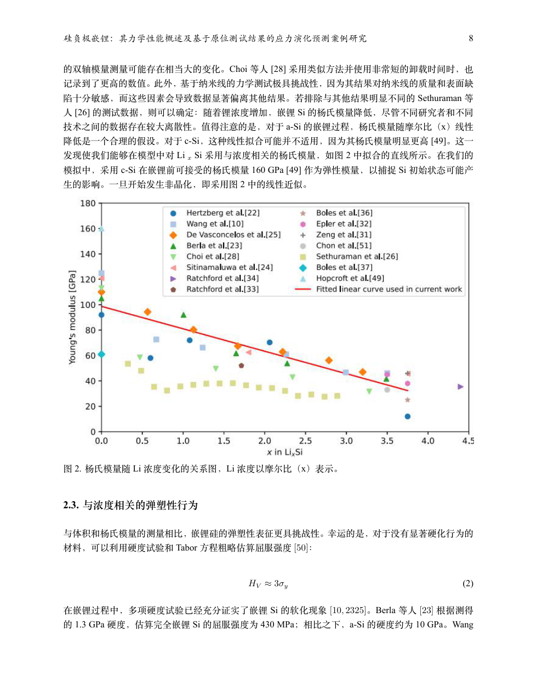
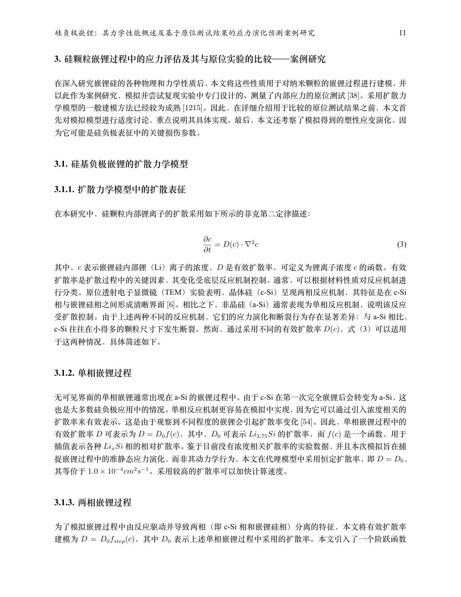

# pdf2zh

Zotero PDF 全文翻译插件，基于 [LuckYang1/PDF-to-md](https://github.com/LuckYang1/PDF-to-md) 改造。
保留 MinerU 的 Markdown / HTML 解析和附件导出，新增“翻译至 PDF”：解析 PDF、分片翻译与语义校订、渲染中文 PDF，并将最终 PDF 附回原文献条目。

**实验性版本，不是安装 XPI 即可运行的独立翻译器。** 翻译功能需要 MinerU、兼容的翻译 API 和另行启动的 PDF 渲染服务。数学修订属于模型推断，重要公式必须人工核对。

[下载 XPI](https://github.com/Qiuyin616/pdf2zh/releases/latest) · [反馈问题](https://github.com/Qiuyin616/pdf2zh/issues) · [English](README-en.md)

## 翻译成果示例

以下为 Mei 等（2026）《硅负极嵌锂：其力学性能概述及基于原位测试结果的应力演化预测案例研究》的实际中文译文 PDF 页面，使用本项目翻译流程及新版渲染服务生成。点击图片可查看原尺寸。

| 中文正文、原论文图表与翻译图注                                                                                                           | 行内公式、独立公式与编号                                                                                                                  |
| ---------------------------------------------------------------------------------------------------------------------------------------- | ----------------------------------------------------------------------------------------------------------------------------------------- |
| [](doc/examples/mei-translated-page-08.png) | [](doc/examples/mei-translated-page-11.png) |

图表内部文字保留原图，不自动重绘或翻译。译文重新排版，不复刻原 PDF 的分页和双栏布局；示例仅展示输出效果，不代表 OCR、翻译和所有公式已通过人工核对。

## 1. 安装插件

1. 从本仓库 [Releases](https://github.com/Qiuyin616/pdf2zh/releases) 下载 `pdf-to-markdown.xpi`，不要使用不含本改造的上游 XPI。
2. Zotero → 工具 → 插件 → 齿轮 → Install Add-on From File / 从文件安装插件。
3. 选择 XPI，重启 Zotero，打开设置中的 **PDF to Markdown**。显示名仍沿用此名称。

已在 macOS + Zotero 9.0.6 上验证翻译及附件导入。manifest 声明的范围不等于测试范围，其他版本、Windows、Linux 仍需验证。

插件 ID 仍为 `pdf-to-md@local`，与上游相同，不能作为两个独立插件同时安装。安装本版本会替换同 ID 的插件；已有设置可能保留。升级前建议备份 Zotero 数据。

## 2. MinerU 和翻译 API

- **在线 MinerU**：在 [API 管理页](https://mineru.net/apiManage/docs) 申请自己的 Token，填写“解析设置 → API Token”。原 PDF 将上传到 MinerU。
- **本地 MinerU**：按 [官方说明](https://github.com/opendatalab/MinerU/blob/master/README_zh-CN.md) 部署兼容 API / Router，再勾选“使用本地 MinerU API”。插件不负责安装 MinerU。
- **翻译 API**：填写供应商的 Chat Completions 基础地址、自己的 Key 和可用模型 ID。插件请求 `<基础地址>/chat/completions`，并发送 `reasoning_effort`。必须核实模型和参数兼容性。

未填写 MinerU Token、且未启用本地 API 时，会尝试轻量接口，当前代码按不超过 20 页处理。在线限额以服务方实际响应为准，长期使用建议配置 Token 或兼容的自建服务。

## 3. 安装和启动 PDF 渲染环境

**普通 Markdown / HTML 解析不需要本节；“翻译至 PDF”必须完成本节。**

下载完整源码 ZIP 并解压，或克隆本仓库 / 自己 fork 后的仓库：

```bash
git clone https://github.com/Qiuyin616/pdf2zh.git
cd pdf2zh
```

入口是 `service/render-service.mjs`，需保留整个 `service` 目录，包括 `render-compatibility.mjs` 和 `math-normalization.mjs`。服务仅使用 Node.js 内置模块，单独运行它不需要 `npm install`，但需要以下系统依赖：

| 依赖            | 用途与安装                                                                                                  | 检查命令                           |
| --------------- | ----------------------------------------------------------------------------------------------------------- | ---------------------------------- |
| Node.js         | 安装 [Node.js LTS](https://nodejs.org/en/download)，运行 HTTP 服务                                          | `node --version`                   |
| Pandoc          | 按 [官方说明](https://pandoc.org/installing.html) 安装，转换 Markdown                                       | `pandoc --version`                 |
| XeLaTeX         | macOS 安装 [MacTeX](https://tug.org/mactex/)，Windows 安装 [TeX Live](https://tug.org/texlive/windows.html) | `xelatex --version`                |
| ctex / 中文字体 | 提供 `ctexart` 中文排版，完整 TeX 发行版通常已包含                                                          | `kpsewhich ctexart.cls` 应返回路径 |

首次安装推荐完整 TeX 发行版，体积较大但缺包排查较少；最小安装需要自行补齐 ctex、字体及 Pandoc 模板依赖。Linux 可通过系统包管理器安装 Node.js、Pandoc、XeTeX 和中文 TeX 支持，再执行上述检查。

### macOS

双击仓库根目录的 **Start-PDF-Renderer.command**。会检查依赖、端口，并补充 Homebrew / MacTeX 的常用 PATH。若 ZIP 解压后丢失可执行权限：

```bash
chmod +x Start-PDF-Renderer.command
./Start-PDF-Renderer.command
```

### Windows

安装依赖后重新打开终端，确认 Node.js、Pandoc、XeLaTeX 和 `kpsewhich` 在 PATH 中，然后双击 **Start-PDF-Renderer.bat**。窗口会保留错误提示；Windows 启动文件尚未在实机验证。

### 通用方式

在仓库根目录运行：

```bash
node service/render-service.mjs
# 或 npm run render-service
```

看到 `Semantic render service listening on http://127.0.0.1:8765` 后，将插件的“渲染服务”设为 **http://127.0.0.1:8765**，不要添加 `/v1/render-markdown`。

保持窗口和进程运行，按 Ctrl+C 停止。**设备重启后需要重新启动；本项目没有配置自动启动。** 重启 Zotero 不会启动渲染服务。端口占用时先确认是否已有服务，不要盲目结束其他程序。

macOS / Linux 修改端口或 Pandoc 路径：

```bash
SEMANTIC_RENDER_PORT=8766 PANDOC_BIN=/path/to/pandoc node service/render-service.mjs
```

Windows CMD 可先执行 `set SEMANTIC_RENDER_PORT=8766` 再运行 BAT。更改端口后同步修改 Zotero 设置。服务仅绑定本机 `127.0.0.1`，没有远程认证方案，不要直接对公网开放。

### 渲染测试

正常排版兼容性：支持 `$…$`、`$$…$$`、`\(…\)`、`\[…\]`、相邻显示公式 `$$a$$$$b$$`；重复外层 `$$$$x$$$$` 会规范为显示公式，代码中的美元符号保持原样。支持常见 `equation / align / gather / multline / aligned / split / array / matrix / cases` 环境和编号、引用；消除独立数学环境被重复包入数学模式的问题。显式带 `\tag` 的行内包裹转为显示公式。过宽普通显示公式会缩放到版心，编号保留在外；极长公式仍可能需要人工分行。

数学字体采用兼容传统 AMS 粗体宏的配置，避免默认 `unicode-math` 与 `\bm` 冲突。需安装 `mathtools`、`amssymb`、`bm`、`mathrsfs`、`graphicx`、`fontspec`、`lmodern`、`fvextra`。常见 Unicode 希腊字母及基础数学符号仅在数学区转换为等价 LaTeX；正文和代码不作公式推断。Unicode 数学字母（例如 `𝐂`、`𝑥`、`𝛔`、`𝒶`）保留原字形，使用 STIX Two Math 或 TeX Gyre Pagella Math 字体，不将粗体字母误降为普通字母。Markdown 与 HTML 表格中的数学单元格会保留为结构化表格。

`siunitx`、`mhchem` 为可选宏包：系统已安装时自动加载；未安装的专用宏、自定义宏或真正不合法的数学语法仍可能退回原文。支持范围通过样例验证，不承诺任意第三方 LaTeX 模板或宏包都能无修改编译。

渲染采用容错回退：先正常排版；遇到公式、原始 TeX 或图片内容错误时，保留可正常排版的内容，将有问题的片段显示为字面原文。无法局部恢复时，输出全文 Markdown 原文 PDF，不因内容编译错误直接丢弃成果。定位最多尝试 24 次，每个渲染子进程最多运行 30 秒。缺少 Pandoc / XeLaTeX、字体或文件写入权限等环境故障仍可能阻止 PDF 输出。

响应头 `X-Render-Mode` 为 `normal`、`partial-raw` 或 `raw`，`X-Render-Fallback-Count` 表示退回原文的片段数。回退不重新调用翻译 API，也不自动更改公式数学含义。运行 `npm run test:render` 可检查回退逻辑，无需启动 Zotero。

运行 `npm run test:render:integration` 可执行真实 Pandoc / XeLaTeX 测试（需要上述渲染依赖）；测试自动使用临时本机端口并在结束后关闭实例。合法常见形式必须满足正常排版、零回退、零缺字，未知命令另测原文回退。响应头 `X-Render-Warning-Count` 和 `X-Render-Missing-Glyph-Count` 供诊断使用，不能把仅有 HTTP 200 当作无缺字的证明。

macOS / Linux 示例：

```bash
curl --fail-with-body http://127.0.0.1:8765/v1/render-markdown \
  -H 'Content-Type: application/json' \
  -d '{"markdown":"# 中文渲染测试\n\n行内公式 $F=ma$。"}' \
  -o renderer-test.pdf
```

打开生成的 PDF 检查中文和公式。服务没有 GET 健康检查；浏览器打开根地址返回 404，不代表服务损坏。

## 4. 使用方法

1. 先启动渲染服务，并填写 MinerU / 翻译设置。
2. Zotero 中选中文献条目或其原 PDF 附件。
3. 右键 → **PDF to Markdown → 翻译至 PDF**。多个 PDF 时选择原论文，不要选择已有译文。
4. 右下角显示上传、排队、解析、翻译第 1 轮、公式复核、可选的翻译第 2 轮（PDF 复核）、渲染 PDF、完成。

如果翻译已经结束、最后渲染或导入失败，选中原始 PDF 附件，使用右键 **PDF to Markdown → 重试渲染（使用已保存译文）**。插件从该附件的最新译文日志恢复公式，调用渲染服务并自动导入 PDF；不重新解析或调用翻译 API。需要保留临时日志目录及图片资源；服务仍需处于运行状态。已存在同名输出时不重复导入。

0.2.3 修复 Zotero 沙箱中缺少全局 `AbortController` 导致无法发起渲染的问题：使用窗口 API，缺少取消控制器时仍可渲染，完整响应读取受超时限制。渲染器兼容公式后紧接数字的写法，并恢复全部重复公式引用。5. 完成后，最终 PDF 附回原条目，原 PDF 保留。结果附件带 `#PDF2MD` 标签，上级条目带 `#PDF2MD-Converted` 标签。

中间 Markdown 不导入文库。成功后尝试清理工作临时目录；失败或清理失败时可能留下临时文件。采用整体完成后导入，因此处理中条目下没有新附件是正常现象。

其他菜单保留：转换为 Markdown、转换为 HTML、导出附件、导出附件到指定位置、显示当前进度。Markdown 配套图片会一并保存 / 导出；HTML 会尝试嵌入图片。

## 5. 设置中每个参数

### 解析设置：MinerU

| 界面参数 / 内部键                      | 含义                                                  | 默认值与推荐                                                                      |
| -------------------------------------- | ----------------------------------------------------- | --------------------------------------------------------------------------------- |
| API Token / `apiToken`                 | 在线 MinerU 凭据，不是翻译 API Key                    | 默认空；在线模式填自己的 Token，本地模式不使用                                    |
| 模型 / `modelVersion`                  | MinerU 的 `vlm` 或 `pipeline`，不是翻译模型           | 默认 `vlm`；先保留，再比较解析质量，以服务端支持为准                              |
| 语言 / `language`                      | 原 PDF 的识别语言，不是译文语言                       | 默认 `ch`；英文论文建议 `en`，中文用 `ch`                                         |
| 公式识别 / `enableFormula`             | 在线 Token / 轻量解析请求的公式选项                   | 默认开；科技论文保持开启                                                          |
| 表格识别 / `enableTable`               | 在线 Token / 轻量解析请求的表格选项                   | 默认开；一般保持开启                                                              |
| 强制 OCR / `isOcr`                     | 强制 OCR，可能改变已有文字层的识别结果                | 默认关；扫描件或文字层错误再开，不建议所有 PDF 都强制 OCR                         |
| 自动转换新增 PDF 附件 / `autoConvert`  | 新增 PDF 自动进行普通 Markdown 解析，不是自动翻译 PDF | 默认关，避免批量导入时意外调用 API                                                |
| 使用本地 MinerU API / `useLocalApi`    | 改用配置的自建服务，不向 mineru.net 上传              | 默认关；服务部署完成后再开；地址也可指向远程自建主机                              |
| API 地址 / `localApiUrl`               | MinerU 服务根地址                                     | 默认 `http://127.0.0.1:8002`；Router 通常 8002，直连通常 8000；末尾不要包含 `/v1` |
| API Key（可选）/ `localApiKey`         | 自建 MinerU 的鉴权 Key                                | 默认空；服务开启鉴权时填，否则留空                                                |
| 类型 / `localApiType`                  | 直连 V1 API（`api`）或 Router V1（`router`）          | 默认 `router`，与实际部署匹配；不是所有 MinerU HTTP 服务都兼容                    |
| Router 并发 / `localRouterConcurrency` | 本地 Router 解析任务并发，范围 1–8                    | 默认 2；资源紧张用 1，多 worker 再提高；不控制翻译 API 并发                       |
| 测试本地 API                           | 连通性 / 接口测试按钮                                 | 本地部署后使用，不测试在线 MinerU、翻译 API 或 PDF 渲染                           |

当前本地 MinerU 4.0 路径使用 Standard 档位；公式、表格、强制 OCR 和语言等在线选项，不应被当成本地路径的等效控制。

### 翻译与语义校订

| 界面参数 / 内部键                     | 含义                                                             | 默认值与推荐                                                                                                                |
| ------------------------------------- | ---------------------------------------------------------------- | --------------------------------------------------------------------------------------------------------------------------- |
| API 地址 / `semanticApiUrl`           | Chat Completions 基础地址，插件追加 `/chat/completions`          | 默认 `https://api.openai.com/v1`；填供应商地址，一般保留 `/v1`，不要填完整 completions 路径                                 |
| API Key / `semanticApiKey`            | 翻译供应商凭据，与 MinerU Token 无关                             | 默认空；仅在本机设置填写，不提交到 GitHub                                                                                   |
| 模型 / `semanticModel`                | 供应商可用的模型 ID                                              | 默认字符串 `gpt-6.1-sol` 仅在测试供应商验证过，不代表默认 OpenAI 地址支持；必须改为自己的供应商可用 ID                      |
| 目标语言 / `semanticLanguage`         | 分片请求中的目标语言                                             | 默认简体中文；系统提示词也指定中文，其他语言未完整验证，推荐保留默认                                                        |
| 思考强度 / `semanticThinkingEffort`   | `none` / `low` / `medium` / `high`，作为 `reasoning_effort` 发送 | 默认 `medium`；先建立质量基线，再比较 `low` 的费用 / 耗时；复杂数学再试 `high`；供应商必须支持对应值，`none` 不等于省略参数 |
| 渲染服务 / `semanticRenderUrl`        | Markdown 转 PDF 基础地址                                         | 默认 `http://127.0.0.1:8765`；不附加接口路径，使用前确认服务运行                                                            |
| PDF 视觉复核 / `semanticVisualReview` | 额外发送原 PDF 和问题列表进行对照复核                            | 默认关；需供应商支持 Chat Completions 的 PDF 文件输入，当前上传整个 PDF，不是局部截图，费用更高且兼容性需验证               |

起步建议：在线 MinerU Token、英文识别语言 `en`、公式 / 表格识别开启、强制 OCR 与自动转换关闭、思考先 `medium` 再对照 `low`、PDF 视觉复核关闭。以自己的账单和同一论文的质量对照评估成本，不保证跨供应商的价格或速度。

### 附件导出

| 参数 / 内部键                              | 含义                                 | 默认值与推荐                            |
| ------------------------------------------ | ------------------------------------ | --------------------------------------- |
| 默认文件夹 / `exportDir`                   | 导出目标，不改变 Zotero 内部存储位置 | 默认空，每次询问；经常导出时选可写目录  |
| 选择                                       | 导出目录选择按钮                     | 使用文件夹选择器，避免不可写系统目录    |
| 每个条目使用单独子文件夹 / `exportPerItem` | 按上级条目分目录导出                 | 默认关；批量导出 / 同名文件多时建议开启 |

`exportLastType` 是内部记忆项，不是设置面板中的用户参数。凭据存储在本机 Zotero 偏好中；密码框遮挡不代表加密存储，不要公开个人 Zotero profile 或完整日志。

## 6. 当前能力与限制

- 第一轮使用 Markdown 和邻近片段上下文，保护图片、表格和数学占位符。模型可提出 OCR、范数、向量 / 张量粗体修订，但属于推断。
- 专门公式复核只处理模型返回的修订候选，不是全部公式审计；没有候选时不发起复核模型调用。
- 行内公式误落正文的候选检测已接入，但没有完善的独立自动应用闭环，不能保证都修好。
- 可选视觉核对上传整个原 PDF，尚未实现按疑点裁剪页面的低成本路线。
- 图片引用有完整性检查，但复合图拆成子图后会导致页数膨胀、图注跨页，不能复刻原论文布局。
- HTML 表格、长公式、特殊 LaTeX、跨片段符号一致性仍需测试，不能保证数学和排版完全一致。
- API 尚无完善的超时 / 重试 / 断点续传；进度没有逐分片计数。停在第一轮可能是正常串行调用，也可能是网络等待，避免反复提交。
- 没有持久化的逐请求 token、缓存、推理及上传 / 下载统计。`cached_tokens` 已计入输入，`reasoning_tokens` 已计入输出，不要重复相加。
- 模型格式错误时存在回退原片段的情况。**完成不代表质量已验收**，应抽查摘要、末尾、图注、数字及关键公式。

## 7. 故障排查

| 现象                   | 检查方法                                                                    |
| ---------------------- | --------------------------------------------------------------------------- |
| 设置能打开，没有新 PDF | 先检查渲染服务；仅安装 XPI 不够；也检查任务是否仍在翻译或被重复结果检查跳过 |
| 长时间翻译第 1 轮      | 查看分片进度与任务日志中的请求/响应时间；不要重复提交                       |
| 401 / 403              | 区分 MinerU / 翻译服务，检查相应凭据、权限、模型资格                        |
| 400 / 模型或参数错误   | 检查供应商支持的模型 / 思考取值，地址不能重复 completions 路径              |
| 429 / 额度不足         | 检查服务限流、余额及 MinerU 配额                                            |
| 渲染 HTTP 500          | 打开翻译日志文件夹，查看完整 HTTP 错误及服务端编译日志                      |
| 根地址返回 404         | 根地址 404 正常；`GET /health` 用于预检查                                   |
| 端口被占用             | 确认已有服务，或更改端口并同步 Zotero 设置                                  |
| 页数明显膨胀           | 常见于复合图独立排版，当前不恢复原版双栏布局                                |

Issue 只提交脱敏的版本、阶段和最小复现，不提交 Key、Token、个人 profile 或无权公开的论文。上传非公开资料到 MinerU / 翻译服务前，请确认相应权限。

### 恢复原文组图（0.2.2）

“翻译至 PDF”会先读取 MinerU ZIP 中的 `layout.json`，用正式 Fig./Figure/图编号的图注与页面坐标识别图组。服务从原 PDF 按整图区域以 300 DPI 裁取，保留原来的分图位置、标签、坐标轴和图例；移除对应碎图和重复分图标签，将双栏图注合并成一个段落后翻译。

完整图组和图注绑定为一个分页单元，居中、等比例缩放，整图最大高度为正文高度的 52%；普通独立图片也限制宽高。正文仍采用单栏阅读版，不能逐页复刻出版方双栏布局。图片内部文字保持原文，不重新翻译或绘制。

裁图需要 Poppler 的 `pdfinfo` 和 `pdftoppm` 在 PATH 中；macOS 启动脚本可复用已安装 Codex 的本机 Poppler。缺少布局文件、图注无法唯一匹配、区域含正文/表格或裁图失败时保留原图片并在 `figures.json` 写出原因，不猜测拼图。旧版服务不支持组图接口，需要更新并重启服务。

日志增加 `figures.json`（每张整图的页码、裁取框、来源碎图、图注与待核对项）、`prepared-source.md`（进入翻译前的组图版本）和 `images/figure-*.png`。原始 Markdown 与 ZIP 保留，可以回溯。

### 本机临时任务日志

右键条目 → **PDF to Markdown → 打开翻译日志文件夹**。每个任务独立保存在 Zotero 临时目录的 `pdftomd-logs/<附件标识>-<时间戳>/`，从任务开始即写入；成功、失败都保留，不随进度窗口消失，也不自动删除。系统清理临时目录时可能删除这些文件，需要长期保留时自行复制。

- `task.json`：原文附件、任务设置与插件版本。
- `timeline.log`：按时间排序的阶段、请求完成、渲染与导入结果。
- `event-*.json`：完整事件，包含每次翻译/公式复核请求的正文、响应、耗时、UTF-8 字节数和供应商用量；请求认证头不记录，已配置 Key/Token 会脱敏。PDF 复核的 base64 二进制不复制到请求日志。
- `status.json`：最终成功/失败状态和完整错误；任务中断且未收尾时保持 `running`，可以结合最后事件判断停在哪一阶段。
- MinerU 原文 Markdown、`result.zip`、`images/`：保留解析产物。
- `translation-result.json`、`translated.md`：每轮翻译/复核后的检查点，在渲染前落盘。
- `render-input.json`：渲染请求，可与同目录图片直接重放；已生成的 PDF 也保留。

服务端另外在系统临时目录的 `zotero-semantic-render-*` 中保留 `input.json`、原文、编译输入和每次 Pandoc/XeLaTeX 的 stdout/stderr、最终状态。其目录由响应头 `x-render-diagnostics-dir` 返回并记入插件日志。日志含论文全文，仅保存在本机；分享前检查内容。可以在任务结束后手动删除不需要的任务目录。

渲染前预检查服务连通性与依赖；旧服务没有 `/health` 时允许其 404 响应继续，但仍记录版本兼容情况。渲染调用最长等待 10 分钟，非 PDF 的 HTTP 200 也视为失败。**更新服务代码后，需要重启渲染服务进程才能启用服务端日志和预检查。**

## 8. 开发、fork 与发布

```bash
npm ci
npm run build
npm run lint:check
```

产物：`.scaffold/build/pdf-to-markdown.xpi`。`npm start` / `npm test` 前按 `.env.example` 配置独立 Zotero 开发 profile，避免影响个人文库。`.env` 不提交。

- `src/modules/pdfToMd.ts`：菜单、队列、MinerU、进度、附件导入及导出。
- `src/modules/semanticRepair.ts`：占位符、分片、修订恢复。
- `src/modules/semanticPipeline.ts`：翻译 / 复核 API 及渲染调用。
- `service/render-service.mjs`：本机 Pandoc / XeLaTeX 服务。
- `Start-PDF-Renderer.command` / `.bat`：快捷启动，不安装依赖或配置自动启动。
- `addon/content/preferences.xhtml` / `addon/prefs.js`：设置和默认值，凭据默认空。

构建工具从仓库元数据生成自动更新地址，指向本仓库固定 `release` tag 下的 `update.json`。推送 `v*` tag 会触发 Release 工作流。fork 后自己发布时，修改 `package.json` 的 repository、homepage、bugs 为自己的仓库，并核实构建后的更新地址。

另一台电脑安装不必 fork 或编译：下载 XPI 和完整源码（运行渲染服务）即可。**不需要把翻译 Key / MinerU Token 填到 GitHub Actions Secrets**，构建不调用这些 API。

## 上游与许可证

保留上游 Git 历史和作者归属，基于 [LuckYang1/PDF-to-md](https://github.com/LuckYang1/PDF-to-md)。
感谢上游引用的 [qingpy/zotero-pdf2md](https://github.com/qingpy/zotero-pdf2md)、[understandlxy/mineru-html-parser-zotero](https://github.com/understandlxy/mineru-html-parser-zotero)、[lisontowind/zotero-mineru](https://github.com/lisontowind/zotero-mineru)。

不是其他同名 / 类似名称 PDF 翻译项目的官方分发。许可证：[AGPL-3.0-or-later](LICENSE)。
